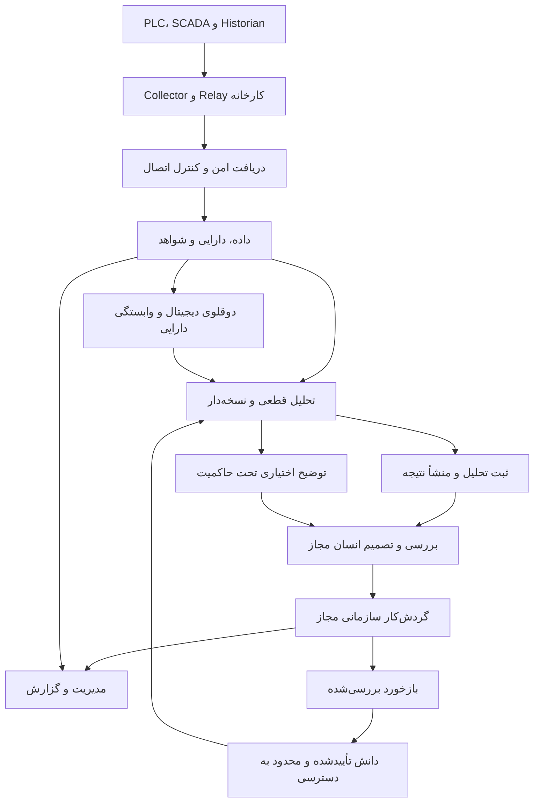

# هرمس — معماری کلان، دفتر فازها و دستور تثبیت مسیر

نسخه: `CANDIDATE-1` — تاریخ بررسی: ۲۰۲۶/۱۱/۰۲  
مخزن: `hermescenter1/hermes-os-nexuz`  
مرجع بررسی: `main@f847f30ee9d0a2f9f4dbee4ed1a28304c23f3fe4`، آخرین commit این شاخه در زمان بررسی: ۲۰۲۶/۱۰/۱۶.

این سند حاصل بررسی هدفمند اسناد معماری، پیاده‌سازی‌های نماینده، مدل داده، قراردادها، تنظیم استقرار و دو PR مرتبط است؛ ممیزی کامل همهٔ مسیرهای محصول نیست. هیچ تست محصول، تماس با کارخانه یا بررسی زندهٔ production انجام نشده است. هیچ تغییری به GitHub ارسال نشده است.

**وضعیت تصمیم:** معماری و برنامهٔ تکمیل زیر پیشنهادی برای تثبیت با مالک هستند. قواعد ایمنی و قراردادهای موجود همچنان معتبرند؛ این سند مجوز تغییر محصول، حذف قابلیت، ادغام خودکار یا انتشار نیست.

## ۱. نتیجهٔ اصلی

هرمس در شاخهٔ بررسی‌شده یک پلتفرم صنعتی و سازمانی با هستهٔ عمدتاً TypeScript/Next.js و ماژول‌های دامنه‌ای است. از ساختار کد و Compose می‌توان آن را «هستهٔ یکپارچه با ماژول‌های دامنه‌ای و workerهای جدا» توصیف کرد؛ این توصیف به معنی اثبات مرزبندی کامل همهٔ importها نیست.

هسته شامل دریافت داده، مدل دارایی، تحلیل قطعی، دانش، نگهداری، عملیات سازمانی، مدیریت و حاکمیت است. وجود ماژول‌ها به معنی اتصال کامل همهٔ آن‌ها، فعال‌بودن flagها یا تأیید اتصال کارخانه نیست.

سه نکته باید در مرجع جدید تثبیت شوند:

1. چند مسیر تحلیل و دانش در هرمس وجود دارد؛ یک API واحد مالک همهٔ استدلال‌ها نیست.
2. هستهٔ تحلیل صنعتی بررسی‌شده قطعی است؛ LLM قابلیت اختیاری و تحت سیاست است. دسترسی به API یک مدل، به معنی آموزش مدل اختصاصی هرمس نیست.
3. محصول در GitHub، کارهای محلی و production سه وضعیت مستقل دارند و باید با شاهد جدا ثبت شوند.

## ۲. معماری کلان پیشنهادی برای تثبیت

نمودار زیر روابط کلان هدف را نشان می‌دهد. هر یال باید با وضعیت مستقل در رجیستری اتصال‌ها ثبت شود؛ همهٔ یال‌های نمودار در main به‌صورت سرتاسری اثبات نشده‌اند.



این معماری مسیر کنترل خودکار PLC یا SIS ایجاد نمی‌کند. گردش‌کار سازمانی مانند تیکت، پرونده یا دستور کار نگهداری نیز فقط در محدودهٔ مجوز، قرارداد و تأیید تعریف‌شدهٔ همان قابلیت مجاز است. نمودار مجوز خودکارسازی این اتصال‌ها نیست.

### لایه‌ها و وضعیت قابل مشاهده

| لایه | مسئولیت | شواهد شاخهٔ بررسی‌شده | مرز وضعیت |
|---|---|---|---|
| کارخانه و Edge | خواندن، buffering، ارسال خروجی از کارخانه | طرح HFCC و قراردادهای OT | طرح Collector/Relay و جزئیات spool در سند هدف است؛ وجود API در Core اثبات نصب در کارخانه نیست |
| اتصال و دریافت | هویت gateway، lifecycle اعتبارنامه، telemetry و heartbeat | `src/lib/ot-edge/`، `src/lib/industrial/`، `/api/industrial/telemetry` | کد دریافت و persistence وجود دارد؛ HFCC کامل در main تأیید نشد |
| داده و زمینه | سازمان، سایت، دارایی، tag، کیفیت و زمان | Prisma، industrial، time-series و digital-twin | هر خواننده و نویسنده باید مجوز سایت و سازمان خود را جدا رعایت کند |
| دانش | پرونده‌ها، کتابخانه، سند، retrieval و مرجع مهندسی | knowledge، documents، rag، industrial-knowledge | این مخازن و runtimeها یکی نیستند؛ flag و سیاست انتشار باید مشخص باشد |
| تحلیل | تشخیص خطا، تحلیل مرجع، KPI و ریسک | industrial-brain، industrial، time-series، predictive | خروجی قاعده‌ای یا heuristic را مدل ML آموزش‌دیده معرفی نکن |
| حاکمیت و ثبت | کنترل provider، citation، trace، ثبت نسخه و replay | ai-governance، reasoning-runs | وجود integration پشت flag به معنی فعال‌بودن آن در production نیست |
| مهندسی | بررسی پروژه، symbol، import و بازبینی | automation-studio، tia-companion، eng-graph | مکمل ابزار سازنده است؛ compile/download به PLC از این معماری نتیجه نمی‌شود |
| عملیات سازمانی | CMMS، EDMS، ERP، CRM، ATS و workflow | ماژول‌های متناظر و capability registry | وجود ERP و Invoice/Payment اثبات تکمیل حسابداری دوبل محلی نیست |
| مدیریت | جمع‌بندی، اولویت‌ها، مشتریان و گزارش دوره‌ای | executive، مستندات dashboard و worker | گزارش تاریخی استقرار باید از تأیید زندهٔ امروز جدا بماند |
| بستر مشترک | احراز هویت، tenant/site، audit، billing، privacy و استقرار | auth، org، site، tenant، security، compliance، release | لایهٔ مشترک است؛ مرجع موازی برای RBAC یا audit ایجاد نشود |

### انتخاب فناوری پایه

| بخش | خط مبنای مشاهده‌شده | تصمیم پیشنهادی |
|---|---|---|
| وب و API | Next.js `15.5.25`، React `19.0.7`، TypeScript | معماری فعلی حفظ شود؛ نسخه‌ها مطابق manifest و lockfile هر release خوانده شوند |
| داده | Prisma و PostgreSQL با image مبتنی بر pgvector/PG16 | منبع اصلی داده باقی بماند؛ extension یا ظرفیت عملیاتی بدون شاهد فعال فرض نشود |
| cache و هماهنگی | Redis 7، workerها و الگوهای claim/outbox در بخش‌های مربوط | الگوی موجود هر دامنه بازاستفاده شود؛ exactly-once سرتاسری فرض نشود |
| UI و زبان | Tailwind، next-intl، FA/EN/DE و قواعد RTL/LTR | Design DNA و قراردادهای موجود حفظ شوند |
| استقرار | Docker Compose، Nginx، workerهای اختصاصی و CI | بازنویسی به microservice یا Kubernetes بخشی از این تثبیت نیست |
| هوش کمکی | adapterهای provider و ai-governance | LLM اختیاری، provider ثبت‌شده و خروجی محدود به سیاست |
| سرویس Python/FastAPI | در سند عمومی به‌عنوان هدف آینده آمده | تصمیم مصوب فعلی فرض نشود؛ استخراج سرویس فقط پس از نیاز سنجیده و ADR |

## ۳. مالکیت مسیرهای تحلیل؛ مهم‌ترین مانع برداشت نادرست

| مسیر | مالک runtime | کار واقعی | اتصال اثبات‌شده در این بررسی |
|---|---|---|---|
| `POST /api/industrial-brain/analyze` | `industrial-brain/analyzer.ts` | تحلیل قطعی گزارش خطا؛ endpoint عمومی و stateless | فراخوانی مستقیم LLM یا corpus مرجع از این موتور نتیجه نمی‌شود |
| `POST /api/brain` | route همراه pipeline، reasoning، retrieval و adapterهای مربوط | پرسش‌وپاسخ مهندسی، history و قابلیت‌های اختیاری | governance و RAG و AI به flag و policy وابسته‌اند؛ فعال‌بودن عملیاتی بررسی نشد |
| پنل reference diagnostic | `industrial-knowledge/runtime/bridge.ts` | تشخیص روی مجموعهٔ مرجع مهندسی با provenance | مسیر مرجع جدا از analyzer آزاد است؛ سند 101-R این جدایی را تصریح می‌کند |
| `POST /api/industrial-brain/runs` | `reasoning-runs/create-run.ts` | ثبت اجرای موتور ثبت‌شده و snapshotها | adapter بررسی‌شده موتور V1 را با هویت نسخه‌دار می‌پیچد؛ خودکار همهٔ تحلیل‌های محصول را ثبت نمی‌کند |
| Digital Twin context | `digital-twin/brain.ts` | topology، وابستگی و زمینهٔ دارایی | API زمینه وجود دارد؛ مصرف آن توسط تک‌تک موتورهای تحلیل نیازمند شاهد جداست |

«ابر دانش» در معماری هدف یعنی مدیریت منابع، مجوز، منشأ، بازبینی و استفادهٔ کنترل‌شده از دانش. به معنی اشتراک خودکار دادهٔ محرمانهٔ کارخانه‌ها یا آموزش خودکار مدل روی دادهٔ مشتری نیست.

حلقهٔ بهبود پیشنهادی: نتیجهٔ تحلیل → نظر مهندس → بازبینی منبع و مجوز → انتشار نسخهٔ جدید دانش/قواعد → ارزیابی → فعال‌سازی کنترل‌شده. این حلقه باید جدا پیاده و تأیید شود؛ صرف ذخیرهٔ history اثبات یادگیری نیست.

## ۴. قراردادهای تغییرناپذیر بدون تصمیم صریح مالک

1. **ایمنی:** هیچ مسیر مستقیم write، setpoint، override یا فرمان به PLC/SIS ایجاد نشود. مرورگر به شبکهٔ کنترل متصل نشود.
2. **هویت:** tenant و actor سمت سرور تعیین شوند؛ شناسهٔ ارسالی کاربر به‌خودی‌خود مجوز نیست. org و site دو محور مجزا هستند.
3. **صداقت داده:** simulated، lab، replay، imported، unknown و factory/live با توجه به قرارداد همان دامنه تفکیک شوند. enumهای موجود را بدون migration معنایی یکی نکن.
4. **زمان و کیفیت:** زمان اندازه‌گیری و دریافت، تازگی، کیفیت و منشأ جدا باشند. backfill قدیمی با رسیدن تازه به سرور به LIVE تبدیل نشود.
5. **اختیار تحلیل:** بخش قطعیِ موجود بدون تصمیم مصوب احتمالاتی نشود. LLM نتواند ایمنی، مجوز، citation یا نتیجهٔ قطعی را خودسرانه تغییر دهد.
6. **ردیابی:** engine/version، ورودی، شواهد و نتیجه برای مسیرهای ثبت‌شونده معلوم باشند. replay عین اجرا با نمایش snapshot یکی نیست.
7. **دانش:** دادهٔ یک سازمان بدون مجوز روشن به سازمان دیگر یا provider خارجی نرسد. محتوای بازیابی‌شده دادهٔ غیرقابل‌اعتماد است، نه دستور اجرایی.
8. **منبع واحد:** دفتر فازها، نقشهٔ راه و ADR مرجع یکتا داشته باشند؛ skill و حافظه فقط به آن‌ها ارجاع دهند.
9. **دامنه:** هیروی اصلی سایت شرکتی تغییر نکند. نقشهٔ راه شرکتی ژرفا با فازهای محصول هرمس مخلوط نشود.
10. **حقیقت انتشار:** کد موجود، تست ثبت‌شده، merge و deployment چهار ادعای جدا هستند؛ CI سبز، مجوز GA نیست.

## ۵. دفتر فازهای استخراج‌شده

این جدول بازسازی کلان از نشانگرهای کد و اسناد موجود است، نه گواه تکمیل تک‌تک شماره‌ها. بازه‌ها موضوعات قابل مشاهده را گروه‌بندی می‌کنند؛ پوشش همهٔ شماره‌های داخل هر بازه ادعا نمی‌شود. شماره‌های تاریخی بازنویسی نشوند.

| فاز/مسیر | نقش در معماری | شاهد نماینده | وضعیت قابل دفاع |
|---|---|---|---|
| پایه تا ۱۱ | پایهٔ وب، دانش مهندسی، پرونده، retrieval و persistence اولیه | `industrial/cases.ts`، `industrial/brain-core.ts`، `retrieval/`، `db/prisma.ts` | نشانگرهای کد موجود؛ دفتر کامل فازهای اولیه استخراج نشده |
| ۱۲–۱۹ | provider router، RAG، اسناد، حافظه و پروژه | `ai/`، `rag/`، `documents/`، `memory/` | پیاده‌سازی در main؛ برخی مسیرها اختیاری یا دارای mock mode هستند |
| ۲۰–۲۷ | analytics، graph، timeline، توصیه و synthesis | `analytics/` و `analytics/agents/` | ماژول موجود؛ نام agent اثبات سامانهٔ چندعاملی مستقل نیست |
| ۲۸، ۳۱–۳۳ | auth، subscription/billing، سازمان و API platform | `auth/`، `billing/`، `org/`، `api/` | اجزای پایه موجود؛ آمادگی تجاری تابع gateهاست |
| ۳۵ | Industrial Gateway و telemetry | `industrial/types.ts` و `/api/industrial/telemetry` | دریافت و persistence در Core موجود؛ اتصال بیرونی مستقلاً تأیید نشده |
| ۳۶ | Digital Twin پایه | `digital-twin/types.ts` و `brain.ts` | در main موجود؛ سخت‌سازی DT-01 جدا و باز است |
| ۳۷ | سری زمانی، KPI و anomaly قاعده‌ای | `time-series/` | پیاده‌سازی موجود؛ ML آموزش‌دیده از آن نتیجه نمی‌شود |
| ۳۸–۴۳ | Copilot، predictive، knowledge، graph، multi-site و site isolation | پوشه‌های دامنهٔ متناظر | پیاده‌سازی موجود؛ اتصال هر مسیر نیازمند شاهد جدا |
| ۴۵، ۴۸–۴۹ | logging/rate limit و گسترش billing/industrial | `logger/`، `billing/feature-gate.ts`، `industrial/alerts.ts` | نشانگر کد موجود؛ پوشش شماره‌های بین آن‌ها ادعا نشده |
| ۵۶–۶۱ | engineering graph، operations، ATS، academy و compliance | `eng-graph/`، `operations/`، `ats/`، `academy/`، `compliance/` | بخش‌های مربوط موجود؛ ATS نقشهٔ راه مستقل دارد |
| ۶۲–۶۷ | SEO، analytics وب، customer portal، CRM و workflow | `seo/`، `customer-portal/`، `crm/`، `automation/` | کد موجود؛ production بودن همهٔ حالت‌ها تأیید نشده |
| ۶۸–۷۰ | ERP، EDMS و CMMS | `erp/`، `document/`، `cmms/` | دامنه‌ها موجود؛ با حسابداری دوبل محلی یکی فرض نشوند |
| ۷۲–۷۸ | Asset Registry و Journal/Editorial/Discovery | `assets/types.ts`، `articles/` | نشانگرهای مربوط موجود؛ وضعیت همهٔ زیرمرحله‌ها جداست |
| ۷۹–۸۲ | Sales Lead، Industrial Brain V1، access gating و Save Case | `sales/lead-workflow.ts`، `industrial-brain/`، routeهای analyze/save-case | کد در main؛ ۸۰ هویت موتور قطعی را دارد؛ عنوان هر زیرمرحله از سند خودش خوانده شود |
| ۸۳–۸۹ | slug/navigation، نقش‌ها، طراحی، آلمانی و سه‌زبانه | `articles/slug.ts`، `navigation/`، `docs/design/phase-87-closure/`، `docs/i18n/` | کد/سند موجود؛ گواه اتمام همهٔ موارد نیست |
| ۹۰–۹۱ | مالکیت Brain/Knowledge و IAM | `storage/brain-owner.ts`، runbookهای 90/90B و PG config 91 | پیاده‌سازی موجود؛ یکسان‌سازی تمام legacyها فرض نشود |
| ۹۲–۹۴ | SRE، acceptance و OT enrollment | runbook 92، اسناد 93، `docs/ot/phase94-secure-enrollment.md` | کد و قرارداد موجود؛ فعال‌بودن OpenBao در production از وجود adapter نتیجه نمی‌شود |
| ۹۵ | AI governance و runtime enforcement | `ai-governance/` و `/api/brain` | wiring پشت flag موجود؛ سند اولیهٔ «binding مرحلهٔ بعد» قدیمی است |
| ۹۶–۹۸ | commercialization، privacy، DR و release engineering | `docs/billing/`، `docs/compliance/`، `docs/release/phase98-*` | سازوکارها موجود؛ readiness مستقل از وجود سازوکار |
| ۹۹، ۹۹٫۶، ۹۹٫۷، ۱۰۰ | security/pilot، reconciliation، cutover و GA closure | اسناد security/release و workflowهای مربوط | بدون خواندن خروجی معتبر و شواهد لازم، حکم GA صادر نشود |
| ۱۰۱ و 101-R | دانش ساختاری مرجع و پل runtime | `industrial-knowledge/` و `phase101r-runtime-ownership.md` | پیاده‌سازی موجود؛ جایگزین V1 نیست و ادعای منابع سند قدیمی باید با موجودی واقعی تطبیق کند |
| ۱۰۲ | Media & Video Hub | `docs/phase102/architecture.md`، `media/` | پیاده‌سازی و gateهای مربوط موجود |
| ۱۰۳ | Voice interface برای Copilot قطعی | `docs/phase103/live-voice-intelligence.md` | کد/طرح موجود؛ گزارش تاریخی، تماس واقعی provider و deployment را اثبات نمی‌کند |
| ۱۰۴–۱۰۶ | Design DNA، discoverability و Journal چندزبانه | `docs/design/phase-104/`، گزارش 105، `docs/phase106/` | اسناد و پیاده‌سازی موجود |
| ۱۰۷ | reliability/visual closure | `docs/design/stage6a/STAGE-6A-REPORT.md` | سند زیرمرحله صریحاً superseded است؛ وضعیت نهایی بدون مرجع نهایی اعلام نشود |
| ۱۰۸ | — | در بررسی هدفمند مدرک کافی پیدا نشد | `NOT_VERIFIED`؛ عنوان یا تکمیل اختراع نشود |
| ۱۰۹-B0 و 109-C | بازنشستگی telemetry ناشناس، Studio/Companion و workspaceها | dashboard-demo، سند 109-C، tia-companion، design locks | کد موجود؛ simulation و import پروژه، اتصال واقعی کارخانه نیست |
| ۱۱۰ | tenant selection/context adoption | `tenant-selection/`، `tenant/` و branch مرتبط | بخش‌هایی موجود؛ عنوان پایان کل فاز بدون سند معتبر اعلام نشود |
| ۱۱۱ | — | سند پیش‌اجرای 112 نبود branch آن را در تاریخ خودش ثبت کرده | وضعیت فعلی `NOT_VERIFIED`؛ غیبت تاریخی را نبود فعلی تلقی نکن |
| ۱۱۲ | Immutable Reasoning Runs و replay | `reasoning-runs/`، migration و PR #107 | `MERGED`؛ PR در ۲۰۲۶/۰۹/۲۵ ادغام شده؛ runtime/deployment امروز مستقلاً بررسی نشده |
| ۱۱۳ | public identity، SEO و cookie governance | `docs/release/phase113-*` | محتوا در main؛ شمارهٔ بالاتر به معنی اتمام فازهای قبلی نیست |
| ۱۱۴ / Brain V2 | نسل دوم تحلیل | گفتهٔ مالک دربارهٔ اجرای محلی؛ اشاره‌های تاریخی در اسناد HFCC | `OWNER_REPORTED_LOCAL`؛ سورس/HEAD و نتیجهٔ فعلی این مسیر در این بررسی در دسترس نبود |
| ۱۱۵ / مجموعهٔ محلی | Twin V2، حسابداری، مدیریت و اتصال کارخانه طبق گزارش مالک | گزارش مالک در گفتگو | انتساب دقیق قابلیت‌ها به زیرمرحله‌های ۱۱۵ نیازمند سند محلی؛ `OWNER_REPORTED_LOCAL` |
| DT-01 | سخت‌سازی Twin و مسیرهای مرتبط | PR #165، head `7d04e0deb9c3b4de19be541c306471dbd7bfb5bb` | در زمان بررسی `OPEN / UNMERGED`؛ نتایج تست متن PR ادعای ثبت‌شده‌اند و اینجا تکرار نشده‌اند |
| HFCC | مرکز اتصال کارخانه | `docs/factory-connection-center/` | معماری و طرح در main، با وضعیت تاریخی Phase 0/HOLD؛ کد کامل `/api/factory-connections` در main پیدا نشد |
| Executive / ATS / HRIS / Accounting / Security | مسیرهای موازی محصول | پوشه‌ها، requirement trackerها، branchها و گزارش‌های مربوط | مستقل از شمارهٔ فاز ثبت شوند؛ کامل‌شدن محلی با merge یا deployment یکی نیست |

## ۶. اختلاف‌ها و تصمیم‌های لازم پیش از قفل نهایی

| شناسه | اختلاف یا ابهام | اقدام محدود لازم |
|---|---|---|
| ARCH-D01 | `docs/ARCHITECTURE.md`، PG/Redis/Compose و ingest را آینده می‌خواند، ولی پیاده‌سازی موجود است | سند قدیمی به‌عنوان نمای اولیه علامت بخورد و به مرجع جدید ارجاع دهد؛ history حذف نشود |
| ARCH-D02 | سند اولیهٔ 95 integration را آینده می‌داند، اما route فعلی wiring پشت flag دارد | وضعیت code-present، enabled و deployed جدا ثبت شود |
| ARCH-D03 | سند HFCC secret manager را resolve-only معرفی می‌کند، اما قرارداد writable و lifecycle وجود دارد | invariant «اسرار OPC UA کارخانه وارد Core نشوند» از credential خود Hermes تفکیک شود؛ header تاریخی کافی نیست |
| ARCH-D04 | اسناد 112 هنوز uncommitted نوشته‌اند، ولی PR #107 merge شده | metadata وضعیت به ledger جاری منتقل و گزارش قدیمی تاریخی باقی بماند |
| ARCH-D05 | راهنمای main نسخهٔ بلند قدیمی است؛ نسخهٔ ۷۳خطی محلی در main نیست | Claude فایل محلی را حفظ و فقط ارجاع لازم اضافه کند؛ نسخهٔ قدیمی روی آن overwrite نشود |
| ARCH-D06 | وضعیت Brain V2، Twin V2، حسابداری و اتصال واقعی فقط گزارش مالک/مسیر محلی است | inventory محلی شامل branch، HEAD، dirty paths، evidence و مرز deployment تهیه شود |
| ARCH-D07 | DT-01 هنوز باز است | در هر تصمیم اتصال سرتاسری، وضعیت hardening وابسته ثبت شود؛ این سند مجوز merge آن نیست |
| ARCH-D08 | سند 101 قدیمی دربارهٔ تعداد منابع با inventory بعدی اختلاف دارد | موجودی مرجع فعلی مبنا باشد؛ اطلاعات بازاریابی منبع حقیقت نشود |

## ۷. نقشهٔ راه تکمیل پیشنهادی؛ بدون جعل فاز ۱۱۶ به بعد

این توالی شمارهٔ فازهای قبلاً مصوب را تغییر نمی‌دهد. شناسه‌های زیر workstream پایدار هستند و تا تطبیق با نقشهٔ راه محلی، شمارهٔ فاز تازه نمی‌گیرند. کار مستقل می‌تواند ادامه یابد؛ وابستگی فقط مسیر متأثر را متوقف می‌کند.

| شناسه و slug | خروجی | وابستگی | معیار پذیرش |
|---|---|---|---|
| H-R00 `source-reconciliation` | ledger یکپارچهٔ remote/local/production | — | هر مسیر دارای source، HEAD و وضعیت قابل دفاع؛ نبود دسترسی صریح ثبت شود |
| H-R01 `architecture-baseline` | مرجع معماری، تصمیم‌ها، phase ledger و registry اتصال‌ها | R00 و تصمیم مالک | وضعیت Candidate/Approved و دامنهٔ قفل صریح؛ ارجاع‌های درست؛ تعارض حل‌شده یا OPEN |
| H-R02 `security-boundary-closure` | تعیین تکلیف hardening و tenant/site در مسیرهای اتصال | R00 | یافتهٔ باز با مالک و gate مشخص؛ تست مرتبط روی همان revision؛ هیچ ادغام خودکار |
| H-R03 `factory-shadow-qualification` | دریافت فقط‌خواندنی در LAB سپس FACTORY | R02 برای مسیرهای متأثر و مجوز محیط | no-write، قطع WAN، spool/replay، duplicate، credential rotation، freshness و quality با شاهد محیط واقعی |
| H-R04 `reasoning-v2-qualification` | تعیین مالک runtime V2، نسخه و ارزیابی | R00 و قرارداد شواهد؛ دادهٔ آزمایش معتبر | dataset نسخه‌دار، regression، unknown/insufficient-evidence، عدم وابستگی اجباری به LLM؛ اتصال به 112 فقط در صورت پیاده‌سازی و آزمون |
| H-R05 `twin-v2-integration` | اتصال asset/tag/time به تحلیل و Twin | R02، R03 برای دادهٔ واقعی و R04 برای V2 | lineage سرتاسری، site scope، graph integrity و stale/unknown درست؛ simulation شاهد کارخانه محسوب نشود |
| H-R06 `enterprise-finance-integration` | اتصال مجاز CMMS/ERP/حسابداری/مدیریت | قراردادهای دامنه و R00 | حسابداری محلی با ledger و معیارهای خودش بررسی شود؛ سند مالی، تأیید و idempotency در تراکنش درست؛ شاخص مدیریتی منبع معلوم داشته باشد |
| H-R07 `governed-knowledge-feedback` | چرخهٔ بازخورد دانش و بهبود نسخه‌دار | R04 و policy دسترسی/انتشار | review و provenance، عدم cross-tenant leakage، مجوز provider، ارزیابی نسخهٔ قبل/بعد؛ یادگیری خودکار ادعا نشود |
| H-R08 `pilot-and-release-closure` | pilot، UAT، DR، ظرفیت، پشتیبانی و release verdict | مسیرهای موردنیاز محصول pilot | gateهای معتبر 99/100 و قراردادهای بعدی با evidence همان release؛ rollback و استقرار مستقل از merge |

### ساختار وضعیت پیشنهادی برای هر آیتم

شناسه، slug، phase اصلی یا `unassigned`، دامنه، وابستگی‌ها، محدودهٔ مجاز، محدودیت‌ها، مالک، criterion و evidence لازم ثبت شود. وضعیت در چهار محور جدا نگه داشته شود:

- منبع: `REMOTE_PINNED / LOCAL_OBSERVED / OWNER_REPORTED / NOT_VERIFIED`.
- پیاده‌سازی: `NOT_STARTED / DESIGN_ONLY / CODE_PRESENT / IN_REVIEW / MERGED`.
- اعتبارسنجی: `NOT_RUN / PASS / FAIL / BLOCKED` به همراه revision، محیط و زمان.
- انتشار: `NOT_VERIFIED / NOT_DEPLOYED / DEPLOYED / VERIFIED_IN_PRODUCTION` با شاهد مستقل.

افزودن capability جدید به نقشهٔ راه، حذف محدودیت ایمنی یا تغییر مرز معماری نیازمند تصمیم ثبت‌شدهٔ مالک است. نگهداری عادی ledger و به‌روزرسانی شواهد تصمیم معماری جدید محسوب نمی‌شود.

## ۸. فایل‌های مرجع پیشنهادی داخل مخزن

اگر معادل معتبر وجود دارد همان حفظ شود؛ دو مرجع هم‌نام با حقیقت متفاوت ایجاد نشود.

| فایل | کاربرد |
|---|---|
| `docs/architecture/HERMES-MASTER-ARCHITECTURE.md` | معماری، مرز دامنه‌ها، مالک runtimeها، تکنولوژی و invariants |
| `docs/architecture/HERMES-PHASE-LEDGER.md` | فازهای تاریخی و وضعیت source/implementation/validation/deployment |
| `docs/architecture/HERMES-ROADMAP.md` | توالی و وابستگی کارهای آینده با معیار پذیرش |
| `docs/architecture/HERMES-CONNECTION-REGISTRY.md` | هر اتصال واقعی بین ماژول‌ها، producer/consumer، قرارداد، mode، auth، evidence و وضعیت |
| `docs/architecture/HERMES-DECISION-LOG.md` یا ADR موجود | تصمیم‌های معماری؛ شماره و تاریخ و مالک تصمیم |
| `docs/ai/prompts/HERMES-CONTINUE.md` | دستور کوتاه شروع و ادامهٔ کار |
| `docs/ai/state/<branch-slug>.md` | checkpoint مختص branch/worktree مطابق ساختار محلی موجود |
| `CLAUDE.md` | فقط ارجاع کوتاه به مرجع و قواعد ثابت؛ راهنمای ۷۳خطی دوباره حجیم نشود |

### Skills و نام‌های فرمان

طبق مستندات رسمی Claude Code، مهارت پروژه در `.claude/skills/<skill-name>/SKILL.md` تعریف می‌شود و می‌تواند با `/skill-name` فراخوانی شود. نسخه و نوع session باید بررسی شود؛ project cloud threadها لزوماً Skills موجود در مخزن را بارگذاری نمی‌کنند. در صورت نبود پشتیبانی، مسیر مستقیم فایل همچنان باید قابل استفاده باشد.

دو slug پیشنهادی، بدون زیرعامل و بدون کپی متن کامل معماری:

- `hermes-architecture`: بازیابی لایه و قرارداد مرتبط، سنجش محدودهٔ درخواست و گزارش انحراف.
- `hermes-roadmap`: یافتن آیتم مرتبط، وابستگی‌ها و قدم بعدی؛ با تغییر کوچک درخواست‌شده به ledger کمک کند.

این مهارت‌ها فقط ارجاع و روش کار کوتاه داشته باشند. هیچ‌کدام اجازهٔ commit، deploy، تماس با کارخانه یا تغییر مدل نمی‌دهند. برای اجرای صرفاً دستی از قابلیت مستند `disable-model-invocation: true` استفاده شود؛ قواعد ثابت کوتاه در CLAUDE.md باقی بماند. Skill طولانی خودش مصرف زمینه ایجاد می‌کند.

مرجع رسمی: https://code.claude.com/docs/en/skills

## ۹. دستور کامل تحویل به Claude Code

متن زیر همراه همین فایل به Claude داده شود:

```text
این بسته را به‌عنوان Candidate معماری و نقشهٔ راه هرمس دریافت کن. هدف، تثبیت مرجع پروژه در GitHub و قابل‌بازیابی‌کردن آن در Claude Code است؛ اجرای فاز جدید یا بازنویسی محصول مجاز نیست.

۱. ابتدا CLAUDE.md و راهنمای مرتبط، وضعیت Git، branch، HEAD و worktree را بررسی کن. راهنمای کوتاه و حافظهٔ کم‌مصرفی که قبلاً ساختیم را حفظ کن. نسخهٔ قدیمی main را روی فایل محلی جایگزین نکن.

۲. مرجع این بسته main@f847f30ee9d0a2f9f4dbee4ed1a28304c23f3fe4 است. اگر remote جلو رفته فقط تغییرات مرتبط را تطبیق بده. کار محلی و uncommitted را از remote و production جدا نگه دار. برای فاز 114/115، Brain V2، Twin V2، حسابداری و اتصال کارخانه فقط metadata و اسناد لازم همان lane را بررسی کن؛ بدون دلیل کل پروژه را نخوان و هیچ lane را تغییر نده.

۳. دو واقعیت remote در این بسته: Phase 112 از طریق PR #107 merge شده؛ DT-01 در PR #165 در زمان بررسی باز بوده است. وضعیت تازه را بررسی و با منبع ثبت کن. ادعای متن PR دربارهٔ تست، اجرای تست توسط خودت نیست.

۴. فایل‌های مرجع معماری، phase ledger، roadmap، connection registry و decision log را مطابق بخش ۸ ایجاد یا با معادل معتبر ادغام کن. شواهد را با SHA و مسیر ثبت کن. متن‌های تاریخی را حذف نکن؛ superseded بودن و مسیر مرجع جاری را کوتاه مشخص کن. از اصلاح انبوه مستندات تاریخی خودداری کن.

۵. برای هر اتصال بین ماژول‌ها وضعیت مستقل ثبت کن: طراحی‌شده، کد موجود، آزمایش‌شده در LAB، آزمایش‌شده در FACTORY، merge یا deployment. هیچ یال نمودار را بدون مسیر producer/consumer و evidence، عملیاتی اعلام نکن. وضعیت unknown یا نبود اتصال را صریح نگه دار.

۶. شماره‌های فاز موجود و نقشهٔ راه مصوب محلی را حفظ کن. H-R00 تا H-R08 پیشنهاد workstream هستند؛ فاز 116 به بعد اختراع نکن. تعارض با برنامهٔ مصوب را با شناسهٔ تصمیم باز ثبت کن. فقط تصمیم‌های صریح مالک Approved شوند و باقی Candidate بمانند. اجازهٔ ذخیرهٔ سند را تأیید معماری یا آمادگی انتشار تفسیر نکن.

۷. invariants این بسته را با قراردادهای موجود تطبیق بده: read-only OT؛ عدم کنترل PLC/SIS؛ tenant/site isolation؛ provenance و freshness؛ LLM اختیاری و غیرمقتدر؛ عدم اشتراک خودکار دانش مشتری؛ نسخه و integrity برای reasoning runs؛ حفظ هیروی سایت شرکتی. تضاد را با حفظ محدودیت فعلی گزارش کن، نه با ضعیف‌کردن آن.

۸. در CLAUDE.md فقط یک ارجاع کوتاه اضافه کن: شروع هر کار با آیتم مرتبط roadmap و قرارداد معماری، بررسی محدود source و ثبت checkpoint. اسناد معماری را در MEMORY.md یا prompt تکرار نکن. وضعیت branch-specific را مطابق ساختار فعلی نگه دار.

۹. نسخه و پشتیبانی واقعی Skills را از راهنمای رسمی همین محیط بررسی کن. اگر supported است، دو مهارت کوتاه با slugهای hermes-architecture و hermes-roadmap در .claude/skills/<slug>/SKILL.md بساز. هرکدام فقط دستور و ارجاع داشته باشد، بدون context: fork، اجرای زیرعامل یا اختیار Git/production. برای فراخوانی دستی disable-model-invocation: true را فقط در صورت پشتیبانی معتبر استفاده کن. اگر skill هم‌نام وجود دارد اول بخوان و بدون ازبین‌بردن دستورهای معتبر ادغام کن. نام فرمان قابل استفاده را گزارش کن؛ کارکرد runtime را بدون شاهد ادعا نکن. اگر محیط آن‌ها را load نمی‌کند، fallback ارجاع مستقیم بده.

۱۰. docs/ai/prompts/HERMES-CONTINUE.md را بساز با این محتوا:
«طبق CLAUDE.md و مرجع معماری هرمس شروع کن. وضعیت همین branch/worktree را تطبیق بده. آیتم مرتبط roadmap، قراردادها و فقط شواهد لازم را بخوان. قبل از تغییر، نتیجهٔ انطباق را کوتاه بنویس: ALIGNED، UNMAPPED یا CONFLICT. ALIGNED را در محدودهٔ درخواست اجرا کن؛ UNMAPPED را به‌عنوان کار پیشنهادی ثبت کن و بخش مستقل مجاز را ادامه بده؛ تغییر قرارداد قفل‌شده در CONFLICT نیازمند تصمیم صریح مالک است. در پایان evidence و checkpoint را به‌روز کن. کار امروز: <شرح کار>.»

۱۱. در این درخواست فقط مستندات و راهنمای عامل تغییر کند. framework، وابستگی، auth، schema، API، CI، تنظیم production و مدل جلسه را تغییر نده. تست محصول و build سنگین برای این تغییر صرفاً مستنداتی لازم نیست؛ صحت مسیرها، linkها، frontmatter، عدم نشت راز، diff و حفظ قواعد قبلی را بررسی کن. از اعداد فرضی مصرف یا درصد پیشرفت استفاده نکن.

۱۲. برای ذخیره در GitHub، در branch مستنداتی مستقل از worktreeهای در حال توسعه کار کن. فقط فایل‌های همین بسته و تغییر محدود CLAUDE.md را stage و commit کن. هیچ تغییر foreign را وارد نکن. این دستور مجوز commit و push همین مستندات و بازکردن Draft PR است؛ مجوز merge یا deploy نیست. پیش از push بررسی کن branch جدید workflow عملیاتی یا deployment ناخواسته را تحریک نکند؛ اگر خطر وجود داشت، مسیر امن‌تر مستنداتی را انتخاب کن و workflow را خودسرانه تغییر نده. اگر محدودیت بالادستی یا دسترسی مانع شد، فایل‌های آماده و دلیل دقیق را گزارش کن.

۱۳. پایان کار کوتاه گزارش بده: branch/commit، لینک Draft PR، فایل‌های مرجع، وضعیت Candidate/Approved، آیتم‌های باز، وضعیت تطبیق 114/115، نام Skills و فرمان‌های در دسترس. هیچ فایل حافظهٔ شخصی، تاریخچهٔ chat یا دادهٔ حساس کارخانه را در مخزن عمومی منتشر نکن.
```

## ۱۰. رجیستری شواهد اصلی

همهٔ مسیرهای زیر در baseline بررسی‌شده وجود داشتند؛ اشارهٔ متن یک سند به فایل دیگر، به‌تنهایی تأیید وجود یا اجرای آن فایل نیست. بررسی صرفاً خواندن/جست‌وجو و تطبیق هدفمند بود.

- [baseline commit](https://github.com/hermescenter1/hermes-os-nexuz/commit/f847f30ee9d0a2f9f4dbee4ed1a28304c23f3fe4)
- `package.json` و `docker-compose.prod.yml`: فناوری‌های فعلی و بسته‌بندی سرویس‌ها.
- `prisma/schema.prisma`: موجودیت‌های واقعی؛ وجود مدل اثبات migration در production نیست.
- `docs/ARCHITECTURE.md`: نمای اولیه با قسمت‌های قدیمی و متناقض با کد فعلی.
- `src/app/api/industrial/telemetry/route.ts` و `src/lib/industrial/telemetry.ts`: دریافت و ذخیرهٔ telemetry و receivedAt سمت سرور.
- `src/lib/digital-twin/brain.ts`: زمینهٔ Twin و قرارداد observe-only.
- `src/app/api/brain/route.ts`: مسیر مهندسی و integrationهای اختیاری.
- `src/lib/industrial-brain/analyzer.ts` و `request-contract.ts`: موتور تحلیل قطعی و ورودی آن.
- `src/lib/reasoning-runs/engine-industrial-brain.ts`: موتور ثبت‌شدهٔ V1 و semantic projection.
- `docs/industrial/phase101r-runtime-ownership.md` و `knowledge-source-inventory.md`: جدایی runtimeها و اختلاف اسناد قدیمی.
- `docs/industrial/phase112-reasoning-run-contract.md`: قرارداد ثبت و replay.
- [PR #107](https://github.com/hermescenter1/hermes-os-nexuz/pull/107): merged، merge commit برابر `26b49cc9793c233f2127a0bbdb4f78ea20b0f7e0`.
- [PR #165](https://github.com/hermescenter1/hermes-os-nexuz/pull/165): open، hardening جدا از baseline.
- `src/lib/ai-governance/` و `docs/ai-governance/phase95-architecture.md`: policy و سند اولیهٔ governance.
- `src/lib/ot-edge/secret-manager.ts`، `http/composition.ts`، `secret-backend.ts` و `docs/ot/phase94-secure-enrollment.md`: قرارداد credential و runtime wiring.
- `docs/factory-connection-center/FACTORY-CONNECTION-CENTER-ARCHITECTURE.md` و `IMPLEMENTATION-SLICES.md`: معماری هدف و برنامهٔ تاریخی HFCC؛ وضعیت اجرای محلی از آن نتیجه نمی‌شود.
- `src/lib/capabilities/registry.ts`: هشت capability عمومی و مسیرهای evidence؛ به‌تنهایی تأیید end-to-end نیست.
- `docs/executive-dashboard/REQUIREMENTS-TRACKER.md`: وضعیت تفکیک‌شدهٔ مدیریت و محدودیت‌های تاریخی.
- `docs/release/phase100-ga-closure-contract.md`: تمایز gate implementation از release approval.
- `docs/design/stage6a/STAGE-6A-REPORT.md`: سند زیرمرحله و اعلام superseded بودن آن.
- `docs/phase103/live-voice-intelligence.md`: مرز voice interface و عدم اختیار کنترل.

### محدودیت و قدم بعدی

قدم بعدی، تطبیق این Candidate با laneهای محلی مالک و ثبت Draft PR مستنداتی توسط Claude است. تا آن زمان این بسته مرجع پیشنهادی است؛ نه گواه وضعیت فعلی کارخانه، نه معماری Approved، و نه مجوز انتشار. برای بررسی یک تغییر آینده، فقط بخش مرتبط این مرجع و شواهد همان مسیر خوانده شود.
