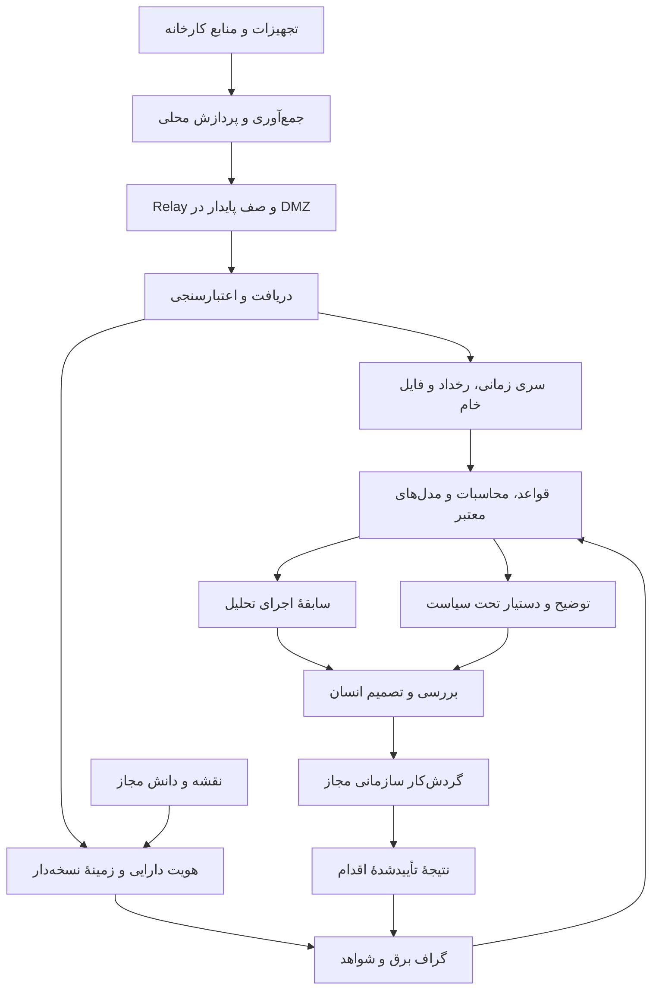

# هرمس — معماری هدف برای رهبری تخصصی در هوش صنعتی برق

> **وضعیت ثبت در مخزن هرمس**
>
> - **جهت‌گیری معماری:** مرجع تصمیم‌گیری توسعهٔ آینده، طبق دستور مالک.
> - **وضعیت پیاده‌سازی:** هر قابلیت باید جداگانه با شواهد تعیین شود. وجود یک قابلیت در این سند به معنی پیاده‌سازی یا تکمیل آن نیست.
> - **مجوز اجرای این درخواست:** فقط ثبت مستندات. این ثبت مجوز اجرای فاز، تغییر کد، نصب وابستگی یا افزودن فناوری نیست.
>
> این سند معماری هدف است و گزارش‌های معماری موجود (از جمله `docs/ARCHITECTURE.md`)، دفتر فازها و نقشهٔ راه قبلی را جایگزین نمی‌کند. شماره، ترتیب و وضعیت فازها با این سند تغییر نمی‌کند و فاز جدیدی تعریف نمی‌شود.
>
> منبع: `HERMES-GLOBAL-TARGET-ARCHITECTURE-FA.md` ارائه‌شده توسط مالک در ۲۰۲۶/۱۱/۰۲، SHA-256 `5c1eabd2ae59db2e54d9f0d3942a88489ac507c64c9ad86b643b6cfde4ded163`. متن زیر بدون ویرایش محتوایی ثبت شده است؛ برچسب `TARGET-CANDIDATE-2` و توضیح بخش ۱۴ دربارهٔ Approved نشدن خودکار، بخشی از متن اصلی‌اند. سند مکمل `HERMES-ARCHITECTURE-ROADMAP-HANDOFF-FA.md` که در متن به آن ارجاع شده، در زمان این ثبت در مخزن موجود نیست.

---

تاریخ: ۲۰۲۶/۱۱/۰۲  
وضعیت: `TARGET-CANDIDATE-2` — پیشنهاد معماری و برنامهٔ پژوهش/توسعه؛ هنوز Approved یا پیاده‌سازی‌شده نیست.

این سند مکمل «HERMES-ARCHITECTURE-ROADMAP-HANDOFF-FA.md» است و آن گزارش وضعیت را جایگزین نمی‌کند. مبنای محصول، بررسی هدفمند `main@f847f30ee9d0a2f9f4dbee4ed1a28304c23f3fe4` و محتوای جاری همان گزارش است. وضعیت محلی V2، حسابداری و اتصال کارخانه در این بررسی تازه آزمایش نشده است. منابع خارجی، منابع رسمی انتخاب‌شده برای مقایسهٔ الگوها هستند؛ ممیزی جامع رقبا یا اثبات برتری جهانی انجام نشده است.

## ۱. تصمیم راهبردی پیشنهادی

هدف قابل دفاع برای هرمس: **مرجع تصمیم‌یار برق صنعتی که هر نتیجهٔ مهم آن به تجهیزات، نقشه، رویداد، محاسبه، منبع دانش و بازبینی مهندس قابل ردیابی باشد.**

مزیت پایدار باید از ترکیب این دارایی‌ها ساخته شود:

- مدل تخصصی تجهیزات و مدارهای برق، اتوماسیون و حفاظت.
- داده و پروندهٔ خطای واقعی با مجوز استفاده و نتیجهٔ تأییدشده.
- اتصال معنایی نقشه، tag، رخداد، تعمیر و تحلیل.
- محاسبات و مدل‌های قابل اعتبارسنجی و مستقل از تولید متن.
- سابقهٔ تصمیم و نتیجهٔ اقدام، همراه با مشخص‌بودن خطا و عدم قطعیت.

تعداد agent، بزرگی LLM، تعداد dashboard یا تعداد فناوری‌ها شاخص برتری نیست. برتری باید برای کاربرد تعریف‌شده، روی دادهٔ مستقل و با معیار هزینه، دقت، تأخیر، امنیت و ارزش عملیاتی اثبات شود. وعدهٔ «دانش کامل» یا «بدون خطا» به معماری تبدیل نمی‌شود.

## ۲. از الگوهای جهانی چه می‌آموزیم؟

| مرجع رسمی | قابلیت توصیف‌شده در منبع | برداشت معماری پیشنهادی برای هرمس |
|---|---|---|
| Siemens Intelligence Center X | پیوند context، graph، intelligence و action با نظارت انسان | یک مدل زمینهٔ مشترک و حاکمیت سرتاسری برای قابلیت‌های هرمس تعریف شود [S1] |
| Cognite Data Fusion | contextualization و پیوند منابع صنعتی ناهمگون | کار اصلی اتصال هویت tag، سند، دارایی و work order است؛ افزودن فایل به RAG کافی نیست [S2] |
| AVEVA PI Server | گردآوری و نگهداری دادهٔ عملیاتی همراه با asset context | historian، event و asset context باید قرارداد و ظرفیت مستقل داشته باشند [S3] |
| ETAP Digital Twin | مدل‌سازی و تحلیل مهندسی شبکهٔ برق و حفاظت | دوقلوی برق باید قابلیت محاسبات و scenario معتبر داشته باشد؛ نمایش سه‌بعدی به‌تنهایی کفایت نمی‌کند [S4] |
| OPC UA و IDTA AAS | مدل اطلاعات و تبادل ساختاری دارایی | به‌جای تکیه بر نام tag، هویت و معنای نسخه‌دار به داده بدهیم [S5، S6] |

این جدول رتبه‌بندی محصول‌ها یا ادعای برابری هرمس با آن‌ها نیست. ادعاهای بازاریابی vendor، تضمین مستقل عملکرد نیستند. انتخاب و ترکیب زیر، قضاوت معماری این گزارش است.

## ۳. توپولوژی هدف و مرز اعتماد



این نمودار هدف توسعه است؛ وضعیت هر اتصال در Connection Registry باید جدا ثبت شود. feedback به graph مسیر بازبینی دارد، نه write خودکار از متن آزاد به دانش authoritative.

سه محل استقرار با یک قرارداد دامنه پشتیبانی شوند:

1. **On-prem مستقل:** دریافت، ذخیره، تحلیل قطعی، جست‌وجو و UI لازم در محل؛ نبود اینترنت نباید این قابلیت‌های حیاتی را متوقف کند. LLM محلی فقط در صورت ارزیابی و فراهم‌بودن سخت‌افزار/مجوز اضافه شود.
2. **Hybrid:** دادهٔ خام و اسرار کارخانه محلی؛ metadata یا بستهٔ دانش مجاز طبق سیاست به ابر برود. ارجاع به دادهٔ محلی به معنی اجازهٔ انتقال آن نیست.
3. **Cloud با جداسازی مشتری:** برای مشتری مجاز به میزبانی ابری؛ region، retention، کلید و دسترسی قابل کنترل باشند.

گواهی، endpoint و policy هر استقرار باید روشن باشند. outbound HTTPS معادل data diode نیست: پاسخ شبکه همچنان وجود دارد. کارخانه‌ای با الزام یک‌طرفهٔ فیزیکی، مسیر انتقال مخصوص و اعتبارسنجی مستقل لازم دارد. مسیرهای شبکه و zoneها باید با الزامات OT، قابلیت دسترس‌پذیری و ایمنی همان محیط طراحی شوند [S7].

## ۴. هستهٔ دانش تخصصی برق

### ۴.۱ هویت و مدل معنایی مشترک

برای هر موجودیت یک شناسهٔ پایدار و mapping به سامانهٔ مبدأ لازم است. تغییر tag name نباید تاریخچهٔ تجهیز را قطع کند. مدل اولیه برای یک کاربرد منتخب کوچک بماند و سپس گسترش یابد:

- ساختار: سازمان، سایت، ناحیه، خط، پست، تابلو، باس، فیدر و تجهیز.
- تجهیزات: ترانس، موتور، درایو، کلید، CT/VT، رله، UPS، باتری، کنتور، بانک خازنی، PLC، remote I/O و سنسور.
- مهندسی: circuit، terminal، cable، signal، interlock، permissive، PLC block، I/O channel و parameter version.
- شواهد: measurement، alarm، event، waveform، drawing revision، maintenance finding، inspection و incident.
- استدلال: hypothesis، supporting/contradicting evidence، rule، calculation، uncertainty، recommendation، approval و observed outcome.

روابط باید نوع‌دار باشند؛ `feeds`، `protectedBy`، `measuredBy`، `controlledBy` و `dependsOn` معنای یکسان ندارند. وجود رابطهٔ `controlledBy` در مدل، مجوز کنترل تجهیز از هرمس نیست.

برای هر property یا رابطه، این اطلاعات برحسب کاربرد ثبت شود: واحد و dimension، فاز، scale، نسبت CT/VT، زمان اعتبار در واقعیت، زمان ثبت در سامانه، منبع و نسخه، scope دسترسی، کیفیت و وضعیت review. دادهٔ مشاهده‌شده، فرض مهندسی و پیشنهاد استخراج‌شده با AI سه طبقهٔ جدا هستند.

### ۴.۲ تطبیق استانداردی در مرزها

| مرجع | استفادهٔ پیشنهادی | محدوده |
|---|---|---|
| OPC UA Information Models | mapping هویت و معنای منبع، کیفیت و مشخصات اندازه‌گیری | هر endpoint و companion model جدا بررسی شود؛ OPC UA به‌تنهایی read-only نیست [S5] |
| AAS / IDTA | بسته و submodel تبادل‌پذیر اطلاعات دارایی | adapter در مرز؛ جایگزین عجولانهٔ schema محصول نشود [S6] |
| IEC 61850 | مدل تجهیزات/عملکرد و mapping دادهٔ اتوماسیون پست | برای پست و IED مربوط؛ پشتیبانی و انطباق کامل ادعا نشود [S8] |
| CIM، خانوادهٔ IEC 61970/61968 | تبادل مدل منابع و شبکهٔ برق | برای شبکه و utility؛ تحمیل همهٔ CIM به هر موتور کارخانه لازم نیست [S9] |
| W3C PROV | طراحی lineage قابل تبادل | Entity، Activity و Agent مرجع مفهوم باشند؛ RDF store از روز اول الزام نیست [S10] |

انتخاب نسخه، دسترسی به متن normative، مجوز و آزمون interoperability بخشی از کار adapter است. این تحقیق، گواه certification یا پوشش کامل استانداردها نیست.

در importها، IEC 61850 SCL مربوط به توصیف پست را با Siemens SCL، یعنی Structured Control Language، هم‌نام فرض نکن؛ نوع artifact و parser جدا باشند.

### ۴.۳ گراف یک مدل دانش است، نه الزام به یک پایگاه دادهٔ جدید

گراف دارایی موجود، engineering graph و knowledge graph ابتدا در یک مدل معنایی و mapping registry هماهنگ شوند. قابلیت query و نسخه‌بندی می‌تواند از PostgreSQL فعلی شروع شود. اضافه‌کردن graph database فقط زمانی مجاز است که queryهای موردنیاز و benchmark نشان دهند پیاده‌سازی فعلی کافی نیست؛ مدل source of truth و projection جدید نباید دو حقیقت متعارض بسازند.

هیچ رابطهٔ استخراج‌شده با OCR یا LLM مستقیم وارد topology معتبر یا تنظیم حفاظت نشود. ابتدا proposed edge همراه سند و محل دقیق شاهد؛ سپس review و انتشار نسخه.

## ۵. دادهٔ عملیاتی، event و ظرفیت

### ۵.۱ قرارداد دریافت

هر batch یا event باید طبق قرارداد نوع‌دار اطلاعات لازم خود را داشته باشد: tenant/site/gateway معتبر سمت سرور، source و stream identity، شناسهٔ یکتای event، sequence/epoch در صورت پشتیبانی، زمان مبدأ و دریافت، کیفیت، واحد، schema version و hash/امضای لازم.

اعتماد به زمان و sequence مبدأ مطلق نیست. reboot، reset counter، drift ساعت، out-of-order، duplicate و backfill باید مدل شوند. `receivedAt` فقط زمان رسیدن را می‌گوید؛ تازگی اندازه‌گیری باید با source time، clock trust، mode و policy تعیین شود. late event، هشدار تاریخی ایجاد کند و بی‌دلیل به «خطر فعلی» تبدیل نشود.

Collector فقط با مجوز read در منبع و سطح شبکه کار کند. scope با نامی مثل `industrial.write` در API هرمس ممکن است فقط اجازهٔ نوشتن در پایگاه هرمس باشد؛ این نام به معنی اجازهٔ write به PLC نیست.

### ۵.۲ دوام و تکرار

edge spool، backpressure، retry، dead-letter/quarantine و سیاست پرشدن دیسک مشخص باشند. ترتیب لازم معمولاً per stream/asset است، نه ترتیب جهانی همهٔ کارخانه‌ها. پذیرش قطعی batch فقط پس از رسیدن به مرز دوام تعریف‌شده اعلام شود. ایمنی read-only با تست نبود command path و امتیاز محدود منبع اثبات شود؛ صرف تنظیم UI کافی نیست.

الگوی پایه: تحویل قابل تکرار همراه idempotency در اثر نهایی. PostgreSQL transactional outbox و workerهای موجود ابتدا بازاستفاده شوند. اگر fan-out، replay و ingest مستقل نیازمند broker شد، NATS JetStream یک گزینهٔ قابل ارزیابی است؛ مستنداتش redelivery و at-least-once را توضیح می‌دهد [S11]. ویژگی broker جای unique constraint، تراکنش، fencing و آزمون اثر جانبی تکراری را نمی‌گیرد. event sourcing همهٔ محصول و Kafka از روز اول الزام نیست.

### ۵.۳ جداسازی نوع ذخیره‌سازی

| نوع داده | مسیر پیشنهادی |
|---|---|
| تنظیم، سازمان، مجوز، مالی و workflow | PostgreSQL تراکنشی فعلی |
| اندازه‌گیری و event | historian موجود مشتری یا ذخیرهٔ سری زمانی با partition/retention و benchmark |
| فایل، نقشه، waveform و snapshot حجیم | object storage نسخه‌دار با hash، encryption و access policy |
| embedding | index قابل بازسازی با reference و metadata مجوز |
| graph/search/read model | projection نسخه‌دار با lineage تا source of truth |

اندازه‌گیری در هر سایت ضروری است. مثال محاسباتی: ۱۰٬۰۰۰ tag با نرخ ثابت ۱ Hz و بدون کاهش داده، روزانه ۸۶۴ میلیون sample تولید می‌کند. این عدد benchmark هرمس نیست؛ نشان می‌دهد CRUD سطر‌به‌سطر و نگهداری نامحدود برای همهٔ tagها انتخاب مناسبی فرض نمی‌شود. نرخ، deadband، aggregation و retention باید به تفکیک سیگنال تعیین شوند. نمونه‌برداری کم‌سرعت SCADA جای ثبت رخداد سریع یا waveform حفاظت را نمی‌گیرد.

## ۶. موتور استدلال ترکیبی برای برق

### ۶.۱ لایه‌های محاسبه

| لایه | مالک نتیجه | کاربرد |
|---|---|---|
| قواعد قطعی و مهندسی | rulepack نسخه‌دار | consistency، حفاظت منطقی، evidence sufficiency و مرز ایمنی |
| محاسبات فیزیکی/عددی | solver معتبر با ورودی صریح | load flow، افت ولتاژ، اتصال کوتاه یا تحلیل سناریو در محدودهٔ مدل |
| تحلیل آماری | الگوریتم و baseline نسخه‌دار | trend، anomaly، change point و کیفیت سیگنال |
| ML تخصصی | مدل آموزش‌دیده و ارزیابی‌شده | الگوهایی که داده و label کافی برای آن‌ها وجود دارد |
| LLM | محتوای advisory محدود | توضیح، خلاصه، query planning محدود و پیشنهاد فرضیهٔ قابل بررسی |

نسخهٔ اول این معماری باید مرز فعلیِ LLM را حفظ کند: توضیح تحت حاکمیت. اگر بعداً پیشنهاد فرضیه یا برنامهٔ ابزار با LLM اضافه شد، آن مسیر capability جدید با مجوز، دادهٔ آزمون و gate مستقل است. هیچ label تولیدی AI خودکار به علت قطعی حادثه تبدیل نشود.

برای محاسبات شبکه، adapter محدود Python با solverهایی مانند pandapower قابل بررسی است؛ پروژهٔ رسمی power flow، short circuit و state estimation را مستند می‌کند [S12]. این انتخاب جایگزین blanket برای ETAP یا نرم‌افزار تخصصی تأییدشده نیست. هر نوع محاسبه باید با testcase و مرجع مستقل، واحدها، فرض‌ها، topology، پارامترها و دامنهٔ اعتبار خود qualified شود. مطالعهٔ coordination یا arc-flash با یک تابع عمومی load flow حل نمی‌شود.

### ۶.۲ بستهٔ خروجی تصمیم‌یار

هر نتیجهٔ مهم یک بستهٔ قابل ردیابی داشته باشد:

- سؤال و context دقیق، زمان و scope.
- مشاهدات و منابع مستقیم، همراه کیفیت/تازگی.
- فرضیه‌های رتبه‌بندی‌شده با شاهد موافق و مخالف.
- دادهٔ مفقود و دلیل کافی‌نبودن شواهد.
- calculation report شامل واحد، ورودی و نسخهٔ solver.
- تفاوت confidence عددی calibrated با score heuristic؛ score بدون calibration «احتمال واقعی» نام نگیرد.
- پیشنهاد بررسی فقط‌خواندنی و الزام تصمیم انسان در کار مربوط.
- engine/rule/model/corpus versions، graph revision و evidence IDs.
- approval، اقدام ثبت‌شده و نتیجهٔ مشاهده‌شده در رکوردهای بعدی مستقل.

Phase 112 پایهٔ مفیدی برای این بسته است، اما schema و adapter فعلی آن را نباید بی‌بررسی برای هر runtime کافی فرض کرد. exact replay قطعی مستلزم حفظ نسخهٔ اجرایی، داده و محیط لازم است. برای LLM یا محاسبهٔ عددی متأثر از محیط، snapshot/audit با اجرای دوبارهٔ bit-identical یکی نیست. تغییر معنا در موتور، با نسخهٔ تازه و regression عرضه شود.

## ۷. بازیابی دانش با مجوز و استناد

pipeline پیشنهادی: تعیین scope و purpose → resolution شناسه/alias/شمارهٔ قطعه → بازیابی lexical و semantic مجاز → پیمایش محدود graph → rerank → بررسی provenance و کفایت شاهد → پاسخ با citation یا اعلام عدم کفایت.

GraphRAG می‌تواند متن و روابط را برای context ترکیب کند؛ مستندات Microsoft Local Search همین ترکیب را توضیح می‌دهد [S13]. برای هرمس، کاربرد آن کمک به یافتن شواهد است. graph استخراج‌شده با LLM جای topology تأییدشده، محاسبهٔ مدار یا اثبات علت را نمی‌گیرد.

قواعد طراحی پیشنهادی:

- ACL سازمان، سایت، سند و سطح انتشار پیش از ورود محتوا به retrieval context اعمال شود و هنگام استفاده دوباره کنترل شود.
- graph traversal، embedding، summary، cache و export همگی scope را حفظ کنند؛ فقط فیلتر SQL کافی نیست.
- هر citation به نسخهٔ مشخص سند/صفحه/بخش یا data window برگردد؛ تغییر سند و لغو دسترسی، invalidation روشن داشته باشد.
- summary عمومی از منابع private تولید نشود؛ حتی عنوان، count و metadata می‌توانند اطلاعات بدهند.
- شمارهٔ قطعه و کد alarm با جست‌وجوی exact/lexical پوشش یابد؛ vector search تنها مسیر نباشد.
- corpus، extraction، prompt و embedding version ثبت شوند؛ reindex به‌صورت incremental و قابل rollback انجام شود.
- دادهٔ بازیابی‌شده، comment کد و PDF دستور قابل اجرا نیستند. ابزارها allowlist، timeout، budget و ورودی schemaدار داشته باشند.

## ۸. دوقلوی دیجیتال با دامنهٔ اعتبار روشن

| سطح | معنی | شرط اعتبار |
|---|---|---|
| ساختاری | topology و ارتباط تجهیزات | review و revision mapping معتبر |
| عملیاتی | state و measurement متناظر با زمان | منبع، کیفیت، تازگی و clock policy |
| تحلیلی | health، جریان‌ها، ریسک و محاسبه | مدل calibrated و testهای مرجع |
| سناریو | what-if روی مدل مستقل | نسخهٔ منجمد ورودی و فرض‌های اعلام‌شده؛ بدون write به کارخانه |

scenario، ادعای «اگر این کار انجام شود قطعاً حادثه جلوگیری می‌شود» نیست. مدل و مرز خطا باید مشخص باشد. به correlation برچسب علت قطعی نزن. state estimation نیز جای measurement واقعی نشان داده نشود.

## ۹. عامل‌ها، اختیار و اجرای پایدار

در صورت نیاز واقعی، نقش‌هایی مانند بازیابی مدار، تحلیل رویداد، محاسبهٔ شبکه، بررسی ناسازگاری شواهد و تدوین گزارش تعریف شوند. هر role ورودی/خروجی typed، ابزار محدود، scope و بودجهٔ خودش را داشته باشد. شروع با یک orchestrator و ابزارهای صریح، سپس افزودن تخصص‌ها بر اساس ارزیابی بهتر از ساخت تعداد زیاد agent بدون معیار است.

توافق چند LLM شاهد فنی مستقل نیست؛ خطای آن‌ها می‌تواند مشترک باشد. پذیرش نتیجه باید به داده، calculation، rule و review متکی بماند.

وظایف طولانی، checkpoint، cancellation، retry، approval expiry و fencing لازم دارند. موتور workflow موجود ابتدا استفاده شود. اگر نیاز به جریان‌های چندروزه و recovery پیچیده تأیید شد، Temporal گزینهٔ ارزیابی است [S14]. فراخوانی LLM و اثر خارجی فعالیت غیرقطعی‌اند؛ replay workflow مجوز تکرار کور اثر نیست. idempotency در مقصد و بررسی مجدد مجوز پیش از اجرا لازم است.

«تصمیم پیشنهادی»، «تأیید انسان»، «ایجاد work order» و «اجرای اقدام» چهار رخداد مجزا باشند. سیستم در این معماری همچنان فرمان مستقیم OT صادر نمی‌کند. خودکارسازی سازمانی مجاز با قرارداد جدا، محدود به CMMS/ERP و سرویس تعریف‌شده است.

## ۱۰. ابر دانش و شبکهٔ تجربهٔ کارخانه‌ها

سه حوزهٔ داده جدا شوند:

1. دانش عمومی دارای مجوز و منابع مهندسی قابل استفاده.
2. دانش خصوصی و experience همان سازمان.
3. بستهٔ تجربهٔ قابل اشتراک که مالک داده انتشار آن را اجازه داده است.

گزارش حادثه پیش از ورود به حوزهٔ سوم باید از نظر مجوز، اطلاعات شناسایی، محرمانگی، صحت نتیجه و خطر بازشناسایی بازبینی شود. حذف نام کارخانه به‌تنهایی کافی نیست. اثر بهبود rule/model با ارزیابی انتشار یابد و در صورت افت کیفیت rollback شود.

فدراسیون در این مرحله یعنی policy و تبادل بستهٔ دانش مجاز یا query کنترل‌شده؛ الزام به federated learning نیست. آموزش مدل اختصاصی زمانی توجیه دارد که corpus معتبر، مجوز، label، هزینه و benchmark نشان دهند از مدل/ابزار موجود بهتر است. دانش اختصاصی هرمس می‌تواند قبل از آموزش LLM بزرگ، در ontology، rulepack، case corpus و evaluation corpus ارزش بسازد.

## ۱۱. ساختار نرم‌افزار و انتخاب فناوری

| جزء | اقدام اکنون | شرط توسعهٔ بعدی |
|---|---|---|
| Next.js/TypeScript | UI، API/BFF و هستهٔ دامنهٔ فعلی حفظ شود | مسیر پرترافیک یا compute-heavy با دلیل از request lifecycle جدا شود |
| PostgreSQL/Prisma | مرجع سازمان، مجوز، workflow و metadata | partition/index و schema محدود با migration کنترل‌شده |
| Redis | cache، هماهنگی و کاربردهای فعلی | تنها منبع سوابق حساس و اثر مالی نباشد |
| Domain contracts | قراردادهای مشترک versioned و adapterهای صریح | migration قرارداد و سازگاری قدیم/جدید |
| Python worker | فقط برای تحلیل عددی/ML توجیه‌شده | sandbox، resource limit، typed API و artifact lineage |
| Object storage | فایل و evidence حجیم با مرجع و hash | backup، retention و restore مستقل |
| Historian/stream | connector موجود مشتری و benchmark اولویت دارند | انتخاب backend با نرخ، retention، query و SLA واقعی |
| Broker/Temporal/Graph DB | اکنون اجباری نشوند | بار و پیچیدگی اندازه‌گیری‌شده، توان عملیات و ADR |
| Kubernetes/HA | تصمیم مبتنی بر استقرار، تیم و SLA | rollout، isolation و availability موردنیاز باید هزینه را توجیه کند |

ساختار هدف یک هستهٔ ماژولار با مسیرهای مستقلِ دریافت داده و محاسبه است؛ microservice‌کردن همهٔ ماژول‌ها شرط جهانی‌شدن نیست. هر دامنه مالک writeهای خودش باشد. shared schema بدون مرز write نباید تنها قرارداد بین سرویس‌ها شود.

جهانی‌شدن علاوه بر ساختار، به نصب قابل تکرار، ارتقای نسخه، rollback، telemetry عملیاتی قابل کنترل، پشتیبانی، documentation، cybersecurity و evidence واقعی نیاز دارد. چندزبانه‌بودن و صفحهٔ عمومی جای این قابلیت‌ها را نمی‌گیرد.

## ۱۲. ارزیابی و معیارهای رهبری

برنامهٔ ارزیابی باید همزمان با توسعه شکل بگیرد. NIST AI RMF و پروفایل GenAI بر مدیریت ریسک و ارزیابی قابل اعتماد تأکید دارند؛ استفاده از آن‌ها به‌معنی اخذ گواهی نیست [S15].

| محور | سنجهٔ لازم | نوع پذیرش |
|---|---|---|
| ایمنی | نبود direct OT write؛ رفتار مناسب هنگام کمبود شاهد | همهٔ caseهای ایمنیِ تعریف‌شده باید gate را بگذرانند؛ این تضمین کل جهان نیست |
| جداسازی | tenant/site، graph، retrieval، cache، summary و export | صفر نشت در corpus آزمون؛ تست منفی و ابطال دسترسی |
| تشخیص | Top-k علت، precision/recall و abstention | benchmark با نظر مهندس و هزینهٔ خطا؛ threshold بر اساس کاربرد |
| هشدار | false alarms به‌ازای asset-day و lead time | مقایسه با baseline واقعی همان سایت |
| محاسبات | خطای عددی، unit و domain validity | reference cases و tolerance متناسب با solver |
| شواهد | citation correctness و lineage completeness | هر ادعای مهم به شاهد قابل دسترس و نسخه‌دار برسد |
| reliability | lag، backlog، loss reconciliation، recovery و duplicate effects | تحت قطع شبکه، restart و load test هدف |
| هزینه | هزینهٔ هر پروندهٔ حل‌شده، token و زمان مهندس | با مدل ساده‌تر و روش فعلی مقایسه شود |
| ارزش عملیاتی | زمان تشخیص/رفع، تکرار خرابی و توقف | baseline و عوامل مداخله‌گر ثبت شوند؛ ROI فرضی منتشر نشود |

دادهٔ train و test بر اساس incident، زمان و در صورت امکان سایت جدا شوند؛ chunkهای یک سند/حادثه در دو طرف باعث leakage می‌شوند. generalization روی سایت یا تجهیز دیده‌نشده سنجیده شود. label هر حادثه سطح اطمینان و نام reviewer داشته باشد. case synthetic به‌عنوان synthetic بماند و شاهد factory performance نشود.

SLO، RPO، RTO و ظرفیت به تفکیک استقرار تعیین شوند؛ عدد جهانی از این گزارش صادر نمی‌شود. سرویس تک‌ماشینه با Compose، availability چندناحیه‌ای ندارد. اثبات backup فقط با وجود فایل نیست؛ restore و reconciliation لازم است.

## ۱۳. مسیر اجرا با حفظ فازهای هرمس

این برنامه فازهای ۱۱۴/۱۱۵ یا مسیرهای موازی موجود را renumber نمی‌کند و پروژه را از ابتدا نمی‌سازد. H-Rها همان workstreamهای بستهٔ قبلی‌اند؛ این سند خروجی تخصصی آن‌ها را روشن می‌کند.

| ترتیب | اتصال به نقشهٔ قبلی | تحویل محدود و قابل پذیرش |
|---|---|---|
| ۰ | H-R00/H-R01 | تطبیق remote/local/production و ثبت candidate، runtime ownership و Connection Registry |
| ۱ | H-R02/H-R03 | closure مرزهای امنیتی مسیر منتخب؛ ingest فقط‌خواندنی با quality/time و failure tests |
| ۲ | H-R04/H-R05 | یک کاربرد کامل برق: تجهیز ← سند/رویداد ← تحلیل ← run ← بازبینی مهندس |
| ۳ | H-R04/H-R05 | ontology کوچک همان کاربرد، محاسبهٔ qualified و benchmark مستقل |
| ۴ | H-R06 | پرونده و work order مجاز، نتیجهٔ اقدام و شاخص مدیریتی/مالی با منبع روشن |
| ۵ | H-R07 | بستهٔ دانش بازبینی‌شده، نسخه‌بندی، ارزیابی و انتشار کنترل‌شده |
| ۶ | H-R08 | pilot و تکرارپذیری در سایت دوم، سپس تصمیم ظرفیت و ابزارهای مقیاس |

### کاربرد نخست پیشنهادی

**تشخیص مستند تریپ موتور/درایو و تمایز خرابی تجهیز از اختلال تغذیهٔ مشترک.** محدودهٔ دقیق با دادهٔ موجود pilot انتخاب شود.

نمونهٔ سؤال: «چرا موتور خط ۳ تریپ کرد و کدام بررسی بعدی بیشترین ارزش اطلاعاتی را دارد؟»

هرمس باید نمودار تغذیه، mapping tag، دادهٔ قبل و بعد، alarm/SOE، کیفیت ساعت، fault code درایو، نسخهٔ parameter و گزارش تعمیر را کنار هم بگذارد. اگر چند موتور روی باس مشترک همزمان تریپ کرده‌اند، این فقط شاهدی برای بررسی اختلال مشترک است؛ بدون دادهٔ کافی علت قطعی اعلام نشود. سیستم باید فرضیهٔ رقیب، شاهد مخالف، دادهٔ مفقود و بررسی فقط‌خواندنی بعدی را نشان دهد.

تکمیل این کاربرد با ground truth و سایت دوم، از گسترش همزمان ده‌ها قابلیتِ بدون شواهد، معیار عملی‌تری برای بلوغ محصول می‌سازد.

نقش‌های لازم در تیم بر حسب مرحله: مهندس برق/حفاظت، متخصص OT/security، مهندس backend/data، مسئول ارزیابی مدل و مهندس محصول/UI؛ چند نقش می‌توانند ابتدا توسط افراد مشترک انجام شوند. زمان و بودجه بدون موجودی منابع و دادهٔ pilot قابل تعهد نیست.

## ۱۴. تصمیم‌هایی که پیشنهاد می‌شود قفل شوند

- تمرکز اولیه روی برق صنعتی و reliability تجهیزات؛ گسترش شبکه/utility با adapter و کاربرد مستقل.
- هستهٔ تحلیل مهندسی با rules، evidence و محاسبات معتبر؛ LLM تحت سیاست و اختیاری.
- مدل معنایی مشترک و هویت پایدار، با versioning و provenance.
- استقلال عملکرد ضروری کارخانه از اینترنت و provider خارجی.
- read-only OT و جدایی اختیار پیشنهاد، تأیید و اثر سازمانی.
- source of truth روشن و projectionهای قابل بازسازی؛ حذف بازنویسی بی‌دلیل stack.
- benchmark و pilot شرط ادعای عملکرد و توسعهٔ مقیاس.

در وضعیت فعلی این‌ها **پیشنهاد قفل معماری** هستند. ثبت در GitHub نباید خودکار وضعیت Approved به آن‌ها بدهد. سند قبلی همچنان مرجع وضعیت استخراج‌شده است و این سند مرجع هدف پیشنهادی.

## ۱۵. دستور کوتاه برای ادامه با Claude

```text
این سند TARGET-CANDIDATE-2 را در کنار بستهٔ معماری قبلی بخوان. فقط پیشنهاد معماری را با laneهای موجود هرمس تطبیق بده؛ کد محصول یا زیرساخت را تغییر نده. مرجع source را pin کن، claimed/observed/target را جدا نگه دار و ارتباط موارد این سند با H-R00 تا H-R08 و فازهای محلی 114/115 را ثبت کن. تفاوت نسبت به معماری فعلی را در یک backlog کوچک با dependency و acceptance evidence مشخص کن. اولویت پیشنهادی، یک کاربرد سرتاسری تشخیص تریپ موتور/درایو است. هیچ فناوری، LLM یا agent تازه را صرفاً از روی نام این سند نصب یا فعال نکن. تصمیم‌های نیازمند مالک را Candidate نگه دار. اسناد roadmap و skillها فقط به مرجع canonical ارجاع دهند و متن را تکرار نکنند. برای انتشار مستندات از همان مجوز و branch/PR مستنداتی قبلی استفاده کن؛ merge و deploy مجاز نیست.
```

## منابع رسمی

- S1 — [Siemens Intelligence Center X](https://www.siemens.com/en-us/products/intelligence-center-x/): context، graph، intelligence و human oversight؛ توصیف vendor.
- S2 — [Cognite: Data Contextualization](https://resources.cognite.com/en/contextualization): پیوند منابع داده و graph؛ توصیف vendor.
- S3 — [AVEVA PI Server](https://www.aveva.com/en/products/aveva-pi-server/): دادهٔ عملیاتی و asset context؛ توصیف vendor.
- S4 — [ETAP Digital Twin](https://etap.com/software/etap-digital-twin): مدل و تحلیل شبکهٔ برق؛ توصیف vendor.
- S5 — [OPC Foundation: OPC UA](https://opcfoundation.org/about/opc-technologies/opc-ua/): مدل اطلاعات، امنیت و قابلیت گسترش.
- S6 — [IDTA: AAS Specifications](https://industrialdigitaltwin.org/en/content-hub/aasspecifications): ساختار، interface و semantics دارایی.
- S7 — [NIST SP 800-82 Rev. 3](https://csrc.nist.gov/pubs/sp/800/82/r3/final): امنیت OT با توجه به reliability و safety. نسخهٔ ۴ در زمان بررسی draft است؛ نسخهٔ نهایی و draft خلط نشوند.
- S8 — [IEC 61850-7-1](https://webstore.iec.ch/en/publication/67536): اصول و مدل‌های power utility automation؛ این گزارش از شرح رسمی عمومی استفاده کرده، نه ادعای مطالعهٔ متن کامل استاندارد.
- S9 — [IEC 61970-301 CIM](https://webstore.iec.ch/en/publication/31356) و [IEC 61968-11](https://webstore.iec.ch/en/publication/6199): مدل منابع و extension توزیع؛ انتخاب edition اجرایی کار مستقل است.
- S10 — [W3C PROV-O](https://www.w3.org/TR/prov-o/): مدل تبادل provenance.
- S11 — [NATS JetStream](https://docs.nats.io/concepts/jetstream): persistence، replay و redelivery.
- S12 — [pandapower Documentation](https://pandapower.readthedocs.io/en/latest/): قابلیت‌های محاسبات شبکه؛ این گزارش qualification محصول روی هرمس انجام نداده است.
- S13 — [Microsoft GraphRAG Local Search](https://microsoft.github.io/graphrag/query/local_search/): ترکیب graph و متن برای query context.
- S14 — [Temporal Workflows](https://docs.temporal.io/workflows) و [Event History](https://docs.temporal.io/encyclopedia/event-history): durability و replay جریان کار.
- S15 — [NIST GenAI Profile](https://www.nist.gov/publications/artificial-intelligence-risk-management-framework-generative-artificial-intelligence): چارچوب مدیریت ریسک و ارزیابی.

بررسی منابع در ۲۰۲۶/۱۱/۰۲ انجام شد. توصیه‌های طراحی، آستانهٔ مقیاس و ترتیب اجرا قضاوت این گزارش هستند؛ منابع به معنی تأیید هرمس توسط سازمان‌های نام‌برده نیستند.
